# October 20: Planning (45 m)
Wii remote design idea (pink theme for the case, like the peach-themed Wii Remotes)

<table align="center">
  <tr>
    <td align="center" valign="bottom">
      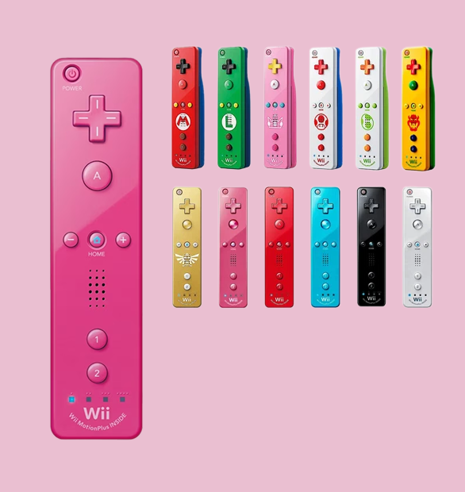
      <br>
      <sub>Wii remote inspo</sub>
    </td>
    <td>&emsp;&emsp;</td>
    <td align="center" valign="bottom">
      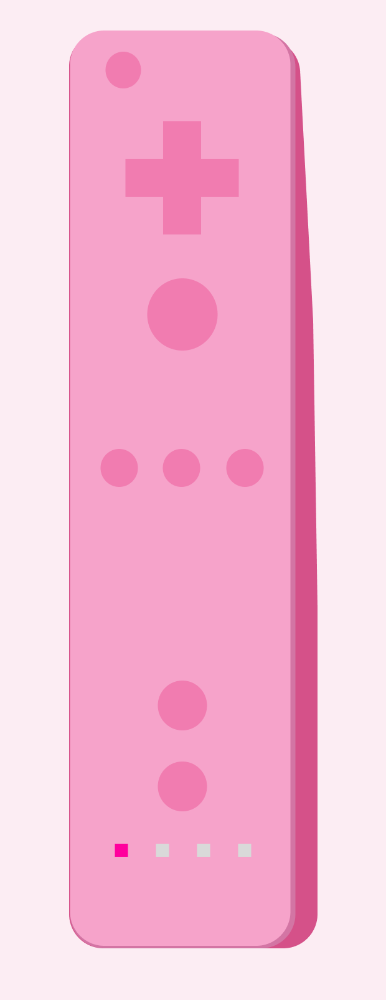
      <br>
      <sub>custom design</sub>
    </td>
  </tr>
</table>
<br>

Dimensions:
+ Length: 147 mm – 148 mm (5.8 in)
+ Width: 36.2 mm (1.43 in)
+ Depth / Thickness: 30.8 mm (1.21 in)

Going to start prototyping with a Raspberry Pi Pico, switches, a joystick and a breadboard. An Arduino won't natively work because it has Serial output. I want to try this and figure out how input mapping works with Dolphin Emulator.

Shoot, I'll need to get header pins for the pico first.

# November 5: More planning ()

works with esp32

[custom gamepad w esp32](https://www.youtube.com/watch?v=dODmsoAu0D4&t=62s) as an example, 

I need to test out what the actions actually do in the Wii (kind of going based on memory), then I can map out where I want to put things (even though it's going to be largely based off of the Wii remote)

### Choosing a board

I think I'll prototype stuff tonight, I just have a XIAO ESP32-S3 on me right now (from the [pear phone](https://github.com/emilyahmad/pear-phone) project)

Arduino pro micro & Leonardo boards support HID, or human interface devices over USB so they're preferred, for now we can use ESP32 over BLE

For the shape I'm debating between a classic hand held controller or the Wii remote I grew up with, I'll probably go with some kind of mix.


### D-pad
For the prototype, I only have a joystick, but I want to use a cross-shaped D-pad in the final design. I'm debating whether or not to use a fulcrum or just having the tactile buttons (the emulator won't be able to recognize multiple inputs, I can just avoid doing this or have it override to whatever was click most recently?)

For general 2D movement: the d-pad on top/case, fulcrum & four contact switches underneath
<p align="center">

<br>
<sub>example vid schematic</sub>
</p>

Probably will have to download this library [ESP32-BLE-Gamepad](https://github.com/lemmingDev/ESP32-BLE-Gamepad) also a [good guide](https://www.instructables.com/ESP32-BLE-GamePad/) in general

Some micro LEDs would be really cool too (for showing P1/P2), these are 0603s 

# Novemebr 6: More planning

Honestly Bluetooth is better than having to have connect over a cable

I'll try both the tactile switches and the joystick for the prototype and see what's easier to read input from and what feels more natural

### Future
+ Adding a screen, 7-segment LEDs and some LEDs for finishing touches would also be nice
+ I'm also considering adding a gyroscope and accelerometer for the shake feature (or spamming another button?)
+ I don't want to waste a bunch of wires on the alphanumeric LCD, and I think the other LCD I have from Egypt needs to be soldered so I'll skip this

### Prototyping

<p align="center">
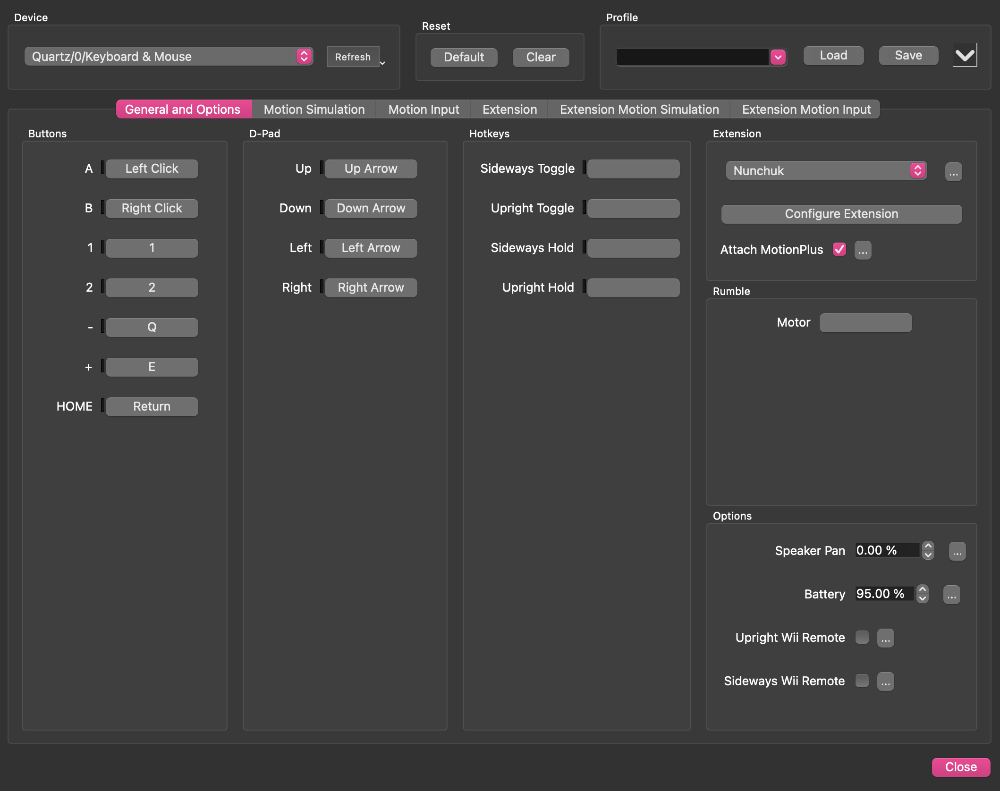
<br>
<sub>emulator controls</sub>
</p>

I'll start with joystick + 7 switches, then replace the joystick with more four switches (if I have enough)

I'll figure out pin placement by seeing what every component needs & assigning the most 
+ joystick: analog for movement, digi for push
>purple = x (D0), yellow = y (D1), ignore digi
+ push button: digi pin + resistor
>can't just wire all the switches to one row with a resistor, that would sync them, they all need individual pull ups - D10, D9, D8

Wait in theory, I could even use an IR remote, maybe I'll try that next.

<table align="center">
  <tr>
    <td align="center" valign="bottom">
      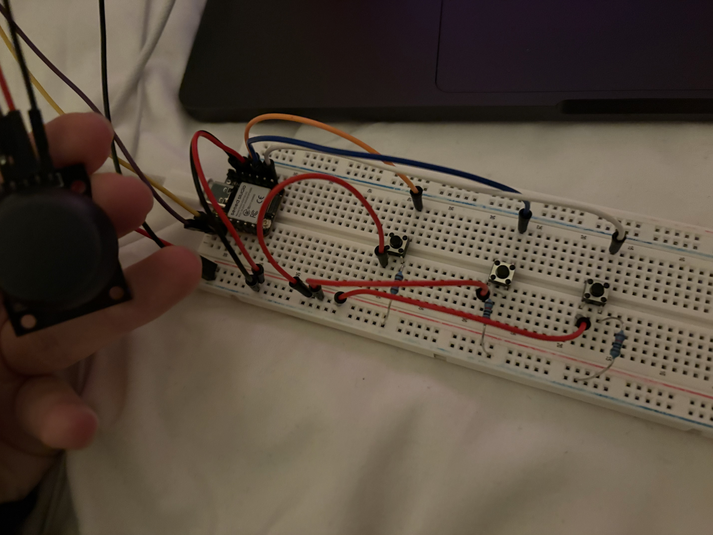
      <br>
      <sub>Wii remote inspo</sub>
    </td>
    <td>&emsp;&emsp;</td>
    <td align="center" valign="bottom">
      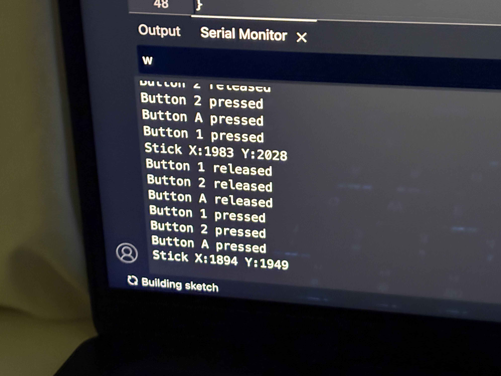
      <br>
      <sub>custom design</sub>
    </td>
  </tr>
</table>

[Tested](/code/prototype.ino), let's connect to emulator.

Install ESP32-BLE-Gamepad library (lemmingDev), flashed [BleGamepad code](/code/gamepad.ino)
<table align="center">
  <tr>
    <td align="center" valign="bottom">
      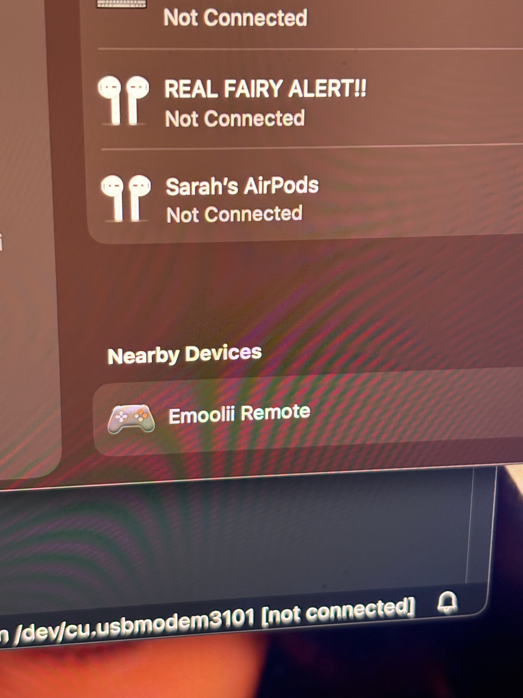
      <br>
      <sub>Pairing</sub>
    </td>
    <td>&emsp;&emsp;</td>
    <td align="center" valign="bottom">
      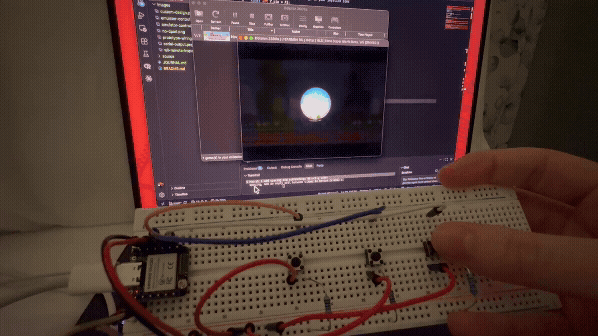
      <br>
      <sub>Push buttons work, need to debug the joystick</sub>
    </td>
  </tr>
</table>

Let's figure out what's going on with the joystick. For reference, I'm orienting it so the wired connection is at the top (pushing towards it = up direction). From searching, the range should be around 0 to 4095, here's what I got from testing:

+ The joystick's baseline position is around (16384, 16384)
+ Pulling Up: (1272, 16384)
+ Pulling down: (32767, 16384)
+ Pulling left: (16384, 32767)
+ Pulling right: (16384, 848)

I'm debating if I sort the input based on the range it falls into, then communicate its assignment as a signal to the gamepad corresponding to each direction.

Debug 1: I set the center to (16384, 16384), also removed joystick push button code

Yeah that didn't work, when I'm mapping the joystick controls, it senses when I pull the joystick in the right direction, but only allows me to select the default/back to the center position
<p align="center">
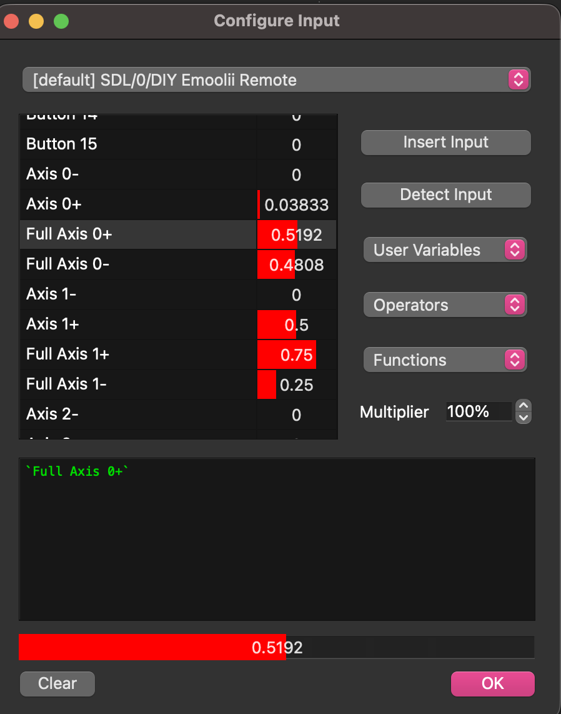
<br>
<sub>Detects joystick should be at .5192 for up direction, but returns to .75 for detect input</sub>
</p>

Oh ok, I actually understand how the input mapping works.

<p align="center">
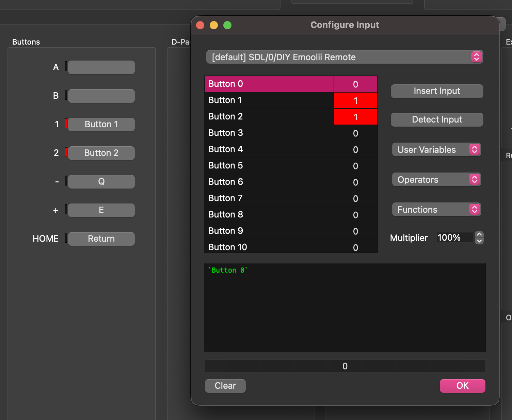
<br>
<sub>Mapping A button</sub>
</p>
By default, the buttons are set to 1 (INPUT_PULLUP) so when we press on them it changes to 0. If we're not sure which button from the list correlates to the physical control, we can just flip the physical component and monitor changes in the list. We select it and press detect input and confirm in the output below (try to clear it unless you're mapping multi-key)

I'm still figuring out the joystick
<p align="center">
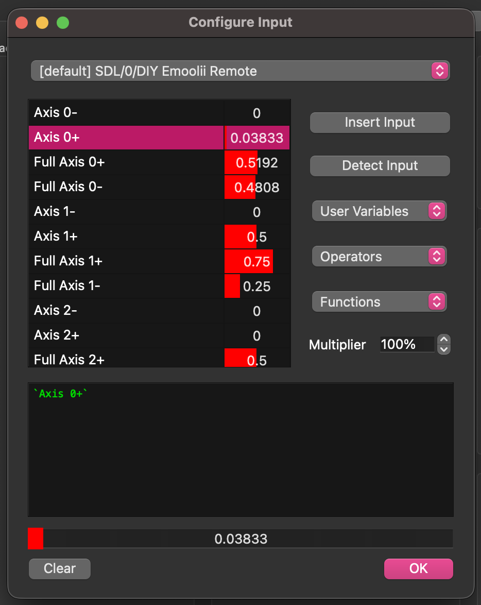
<br>
<sub>Mapping A button</sub>
</p>
We're ignoring the full axis and specifying the changes in 

Ok, it worked for a second, I tiled it diagonally southeast and it navigated down, but it won't move in any other directions.

Ok, I was able to actually diagnose the issue by playing, it constantly is sensing the joystick pulling down, and randomly moved to the left and jumped?
<!-- commenting out so I can push without LFS -->
<!-- <table align="center">
  <tr>
    <td align="center" valign="bottom">
      
      <br>
      <sub>On joining round, bro is already ducking, also just pressing jump also moves him left</sub>
    </td>
    <td>&emsp;&emsp;</td>
    <td align="center" valign="bottom">
      
      <br>
      <sub>Just pressing A (automatically scrolling right - sometimes presses A unprompted)</sub>
    </td>
  </tr>
</table> -->

I should've cropped these movs so they're higher quality gifs. Also yay, it's actually responsive after changing these lines in gamepad.ino

```const int AXIS_MID   = 16384;``` to ```const int AXIS_MID   = 0;```

and
```
int scaleAxis(int raw, int center) {
  int offset = raw - center;

  if (abs(offset) < DEADZONE) return 0;
  long v = (long)offset * AXIS_MAX / 2048;
  return constrain(v, -AXIS_MAX, AXIS_MAX);

}
```
to
```
int scaleAxis(int raw, int center) {
  int offset = raw - center;
  
  if (abs(offset) < DEADZONE) return AXIS_MID;
  long v = AXIS_MID + (long)offset * AXIS_MID / 2048;
  return constrain(v, 0, AXIS_MAX);

}
```

now it's flipped so I'll map Up/Down to +/- 1 and vice versa. Remapped, now left and right are swapped. Awesome, joystick works, now I need to change the way the sprint/power up/[1] button works, wait actually it's lowkey larp. Cuz now instead of having to hold down the [1] while sprinting, you can just click it once and it stays on. This also means power ups would constantly be shooting. I guess that's not always a good thing because you need to make sure you time it correctly.

<p align="center">
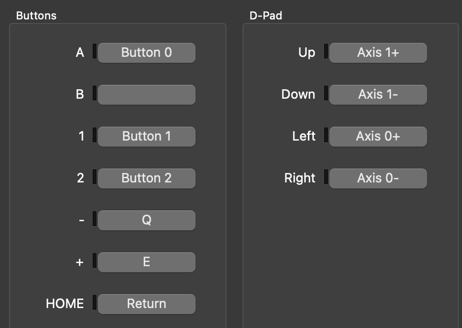
<br>
<sub>Finalized input map</sub>
</p>

I also want to check if I connect it to my phone/any other source of power, will it still work? It should becuase I'm connected over bluetooth?

<p align="center">
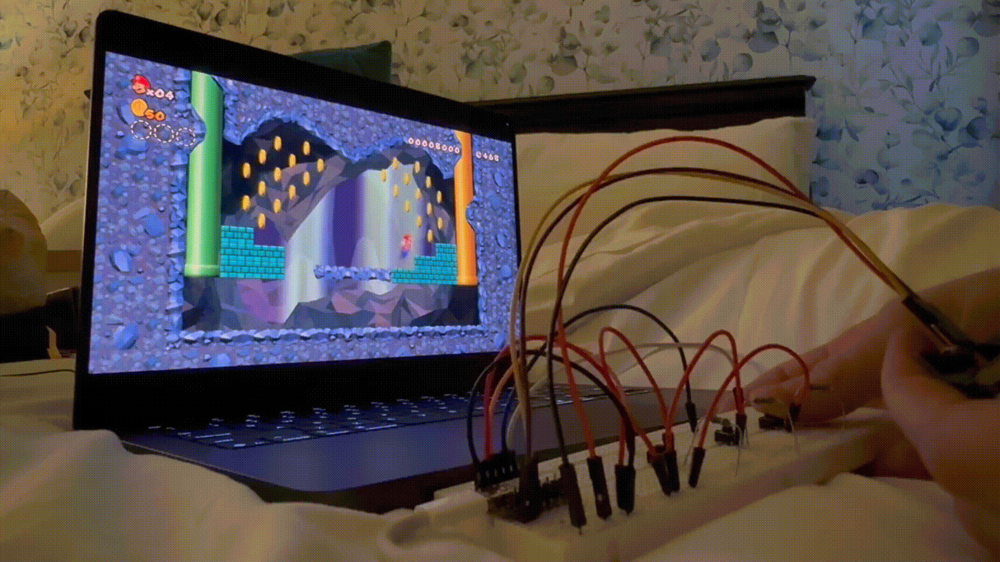
<br>
<sub>Cool runthrough (hotel for hackaday supercon)</sub>
</p>

Ok now I need to figure out the shaking, so maybe gyroscope and accelerometer?