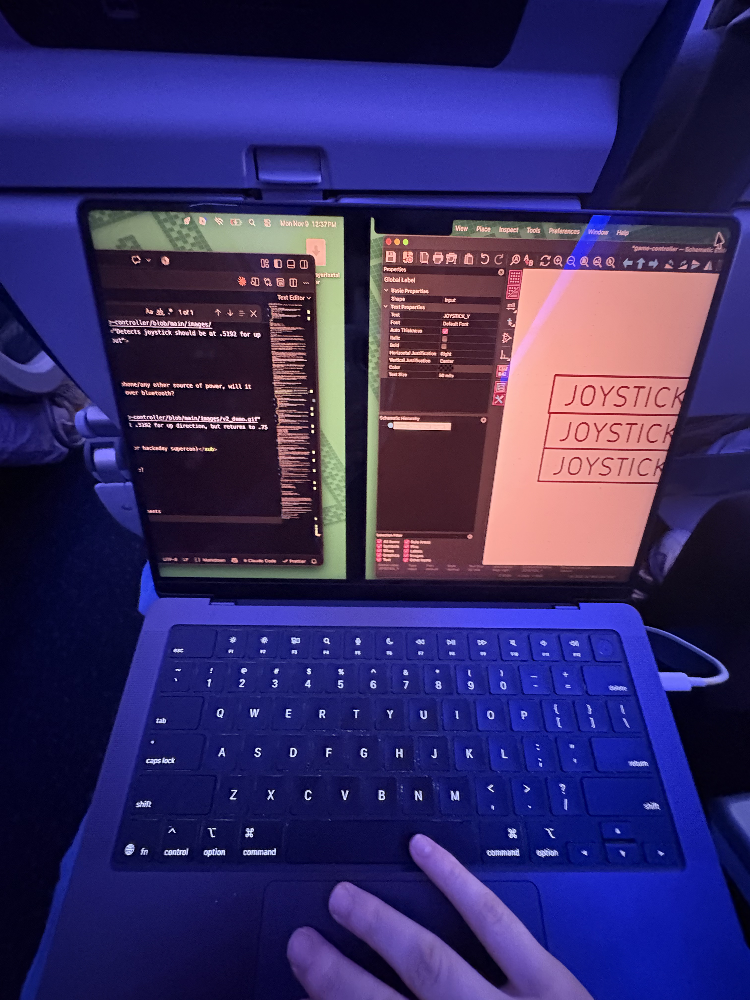
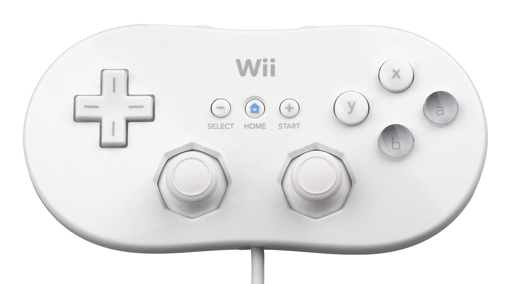
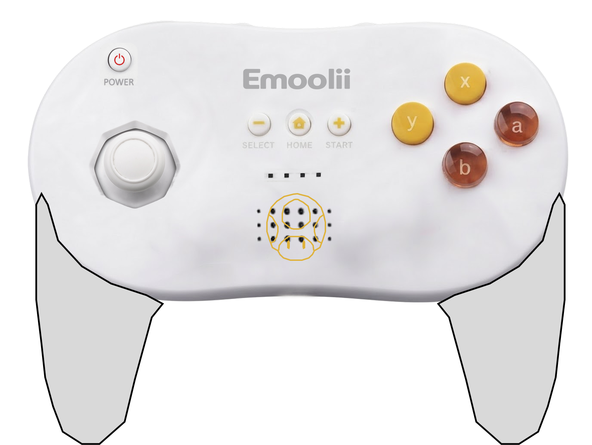
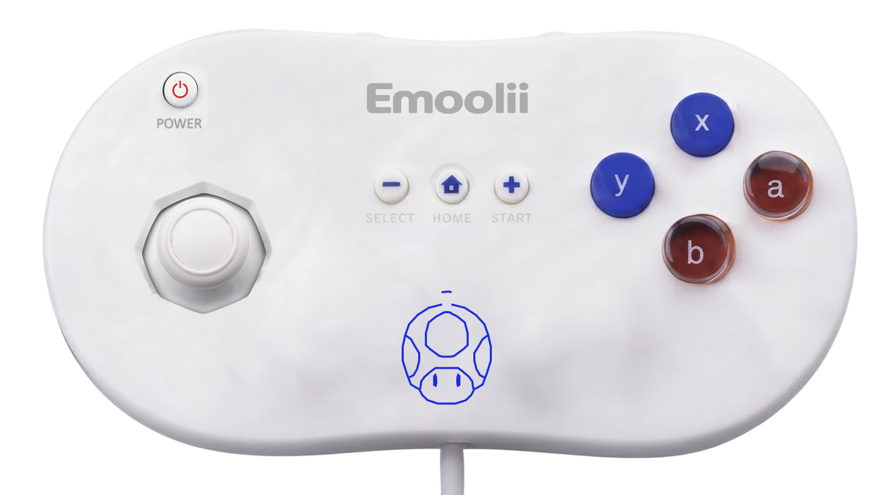
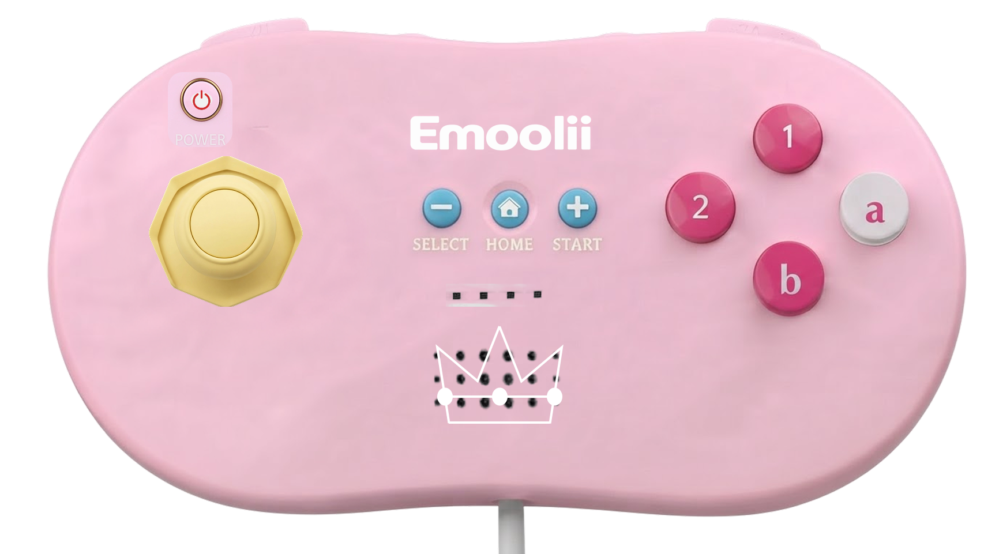
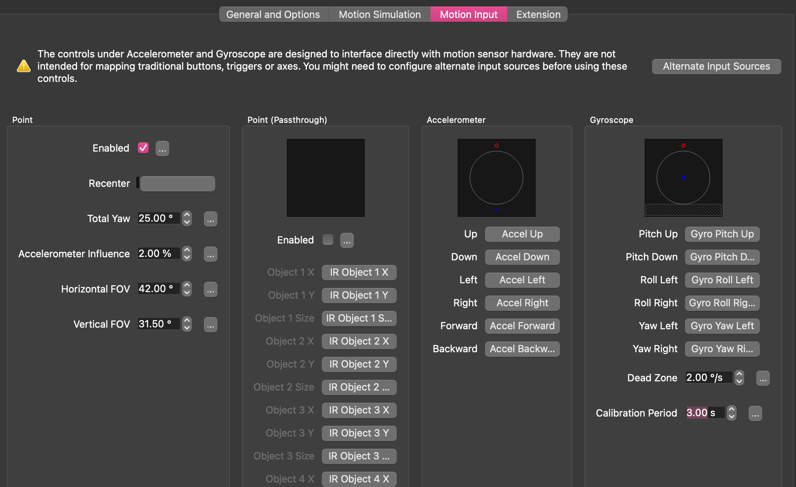

# October 20: Planning (1 hour)
Wii remote design idea (pink theme for the case, like the peach-themed Wii Remotes)

<table align="center">
  <tr>
    <td align="center" valign="bottom">
      
      <br>
      <sub>Wii remote inspo</sub>
    </td>
    <td>&emsp;&emsp;</td>
    <td align="center" valign="bottom">
      
      <br>
      <sub>custom design</sub>
    </td>
  </tr>
</table>
<br>

Dimensions:
+ Length: 147 mm – 148 mm (5.8 in)
+ Width: 36.2 mm (1.43 in)
+ Depth / Thickness: 30.8 mm (1.21 in)

Going to start prototyping with a Raspberry Pi Pico, switches, a joystick and a breadboard. An Arduino won't natively work because it has Serial output. I want to try this and figure out how input mapping works with Dolphin Emulator.

Shoot, I'll need to get header pins for the pico first.

# November 5: More planning (45m)

works with esp32

[custom gamepad w esp32](https://www.youtube.com/watch?v=dODmsoAu0D4&t=62s) as an example, 

I need to test out what the actions actually do in the Wii (kind of going based on memory), then I can map out where I want to put things (even though it's going to be largely based off of the Wii remote)

### Choosing a board

I think I'll prototype stuff tonight, I just have a XIAO ESP32-S3 on me right now (from the [pear phone](https://github.com/emilyahmad/pear-phone) project)

Arduino pro micro & Leonardo boards support HID, or human interface devices over USB so they're preferred, for now we can use ESP32 over BLE

For the shape I'm debating between a classic hand held controller or the Wii remote I grew up with, I'll probably go with some kind of mix.


### D-pad
For the prototype, I only have a joystick, but I want to use a cross-shaped D-pad in the final design. I'm debating whether or not to use a fulcrum or just having the tactile buttons (the emulator won't be able to recognize multiple inputs, I can just avoid doing this or have it override to whatever was click most recently?)

For general 2D movement: the d-pad on top/case, fulcrum & four contact switches underneath
<p align="center">

<br>
<sub>example vid schematic</sub>
</p>

Probably will have to download this library [ESP32-BLE-Gamepad](https://github.com/lemmingDev/ESP32-BLE-Gamepad) also a [good guide](https://www.instructables.com/ESP32-BLE-GamePad/) in general

Some micro LEDs would be really cool too (for showing P1/P2), these are 0603s 

# Novemebr 6: More planning (6 hours)

Honestly Bluetooth is better than having to have connect over a cable

I'll try both the tactile switches and the joystick for the prototype and see what's easier to read input from and what feels more natural

### Future
+ Adding a screen, 7-segment LEDs and some LEDs for finishing touches would also be nice
+ I'm also considering adding a gyroscope and accelerometer for the shake feature (or spamming another button?)
+ I don't want to waste a bunch of wires on the alphanumeric LCD, and I think the other LCD I have from Egypt needs to be soldered so I'll skip this

### Prototyping

<p align="center">

<br>
<sub>emulator controls</sub>
</p>

I'll start with joystick + 7 switches, then replace the joystick with more four switches (if I have enough)

I'll figure out pin placement by seeing what every component needs & assigning the most 
+ joystick: analog for movement, digi for push
>purple = x (D0), yellow = y (D1), ignore digi
+ push button: digi pin + resistor
>can't just wire all the switches to one row with a resistor, that would sync them, they all need individual pull ups - D10, D9, D8

Wait in theory, I could even use an IR remote, maybe I'll try that next.

<table align="center">
  <tr>
    <td align="center" valign="bottom">
      
      <br>
      <sub>Wii remote inspo</sub>
    </td>
    <td>&emsp;&emsp;</td>
    <td align="center" valign="bottom">
      
      <br>
      <sub>custom design</sub>
    </td>
  </tr>
</table>

[Tested](/code/prototype.ino), let's connect to emulator.

Install ESP32-BLE-Gamepad library (lemmingDev), flashed [BleGamepad code](/code/gamepad.ino)
<table align="center">
  <tr>
    <td align="center" valign="bottom">
      
      <br>
      <sub>Pairing</sub>
    </td>
    <td>&emsp;&emsp;</td>
    <td align="center" valign="bottom">
      
      <br>
      <sub>Push buttons work, need to debug the joystick</sub>
    </td>
  </tr>
</table>

Let's figure out what's going on with the joystick. For reference, I'm orienting it so the wired connection is at the top (pushing towards it = up direction). From searching, the range should be around 0 to 4095, here's what I got from testing:

+ The joystick's baseline position is around (16384, 16384)
+ Pulling Up: (1272, 16384)
+ Pulling down: (32767, 16384)
+ Pulling left: (16384, 32767)
+ Pulling right: (16384, 848)

I'm debating if I sort the input based on the range it falls into, then communicate its assignment as a signal to the gamepad corresponding to each direction.

Debug 1: I set the center to (16384, 16384), also removed joystick push button code

Yeah that didn't work, when I'm mapping the joystick controls, it senses when I pull the joystick in the right direction, but only allows me to select the default/back to the center position
<p align="center">

<br>
<sub>Detects joystick should be at .5192 for up direction, but returns to .75 for detect input</sub>
</p>

Oh ok, I actually understand how the input mapping works.

<p align="center">

<br>
<sub>Mapping A button</sub>
</p>
By default, the buttons are set to 1 (INPUT_PULLUP) so when we press on them it changes to 0. If we're not sure which button from the list correlates to the physical control, we can just flip the physical component and monitor changes in the list. We select it and press detect input and confirm in the output below (try to clear it unless you're mapping multi-key)

I'm still figuring out the joystick
<p align="center">

<br>
<sub>Mapping A button</sub>
</p>
We're ignoring the full axis and specifying the changes in 

Ok, it worked for a second, I tiled it diagonally southeast and it navigated down, but it won't move in any other directions.

Ok, I was able to actually diagnose the issue by playing, it constantly is sensing the joystick pulling down, and randomly moved to the left and jumped?
<!-- commenting out so I can push without LFS -->
<!-- <table align="center">
  <tr>
    <td align="center" valign="bottom">
      
      <br>
      <sub>On joining round, bro is already ducking, also just pressing jump also moves him left</sub>
    </td>
    <td>&emsp;&emsp;</td>
    <td align="center" valign="bottom">
      
      <br>
      <sub>Just pressing A (automatically scrolling right - sometimes presses A unprompted)</sub>
    </td>
  </tr>
</table> -->

I should've cropped these movs so they're higher quality gifs. Also yay, it's actually responsive after changing these lines in gamepad.ino

```const int AXIS_MID   = 16384;``` to ```const int AXIS_MID   = 0;```

and
```
int scaleAxis(int raw, int center) {
  int offset = raw - center;

  if (abs(offset) < DEADZONE) return 0;
  long v = (long)offset * AXIS_MAX / 2048;
  return constrain(v, -AXIS_MAX, AXIS_MAX);

}
```
to
```
int scaleAxis(int raw, int center) {
  int offset = raw - center;
  
  if (abs(offset) < DEADZONE) return AXIS_MID;
  long v = AXIS_MID + (long)offset * AXIS_MID / 2048;
  return constrain(v, 0, AXIS_MAX);

}
```

now it's flipped so I'll map Up/Down to +/- 1 and vice versa. Remapped, now left and right are swapped. Awesome, joystick works, now I need to change the way the sprint/power up/[1] button works, wait actually it's lowkey larp. Cuz now instead of having to hold down the [1] while sprinting, you can just click it once and it stays on. This also means power ups would constantly be shooting. I guess that's not always a good thing because you need to make sure you time it correctly.

<p align="center">

<br>
<sub>Finalized input map</sub>
</p>

I also want to check if I connect it to my phone/any other source of power, will it still work? It should becuase I'm connected over bluetooth?

<p align="center">

<br>
<sub>Cool runthrough (background is hotel for hackaday supercon)</sub>
</p>

Only need a MEMs accelerometer (no gyroscope)

Speaker would be cool but not as important

# November 9: Started Schematic (45m)

<p align="center">

<br>
<sub>Starting schematic</sub>
</p>

Input pins into MCU, output pins into components. B (back off remote) will be the joystick push button (D2, change this to a less useful GPIO). I need to figure out where the accelerometer will wire up to (AC), adding LED's could be cool too

# November 10: Thinking about components (30m)

I'll stick with the joystick instead of the fulcrum and switches at least for v1, I like the the idea of LEDs under the buttons lighting up on clicks, maybe a buzzer too?

Passive buzzer with Arduino tone command (only one at a time). Wiis use a speaker not buzzer. I could even make all the audio come out of it like a [bluetooth speaker](https://www.youtube.com/watch?v=FB5XqXd3KdY).

MicroPython or C++? MicroPython is used for testing (run code instantly without waiting for firmware to recompile/upload), but deployed in C/C++ (faster)

The actual dimensions of the remote

# November 11: More thinking about/researching components (2 hours 22m)

I think I'll go for a classic controller look, like this

<p align="center">

<br>
<sub>Wii classic controller</sub>
</p>

But a peach/other character style. Because my sister and I will be the main users, I'll make one peach themed and the other blue toad.

I'll figure out the actual component dimensions
Joystick - 41 mm length × 25.36 mm width
Push button - 6mm x 6mm

The IR camera/image processing is really cool but we won't need it for Super Mario Bros.

[Good information](https://www.youtube.com/watch?v=Reng4j4WrvA) on Wii remote's components.

Should I just use the easy to program XIAO ESP32 or something that's more fitting for this device?

<p align="center">

<br>
<sub>Yellow toad/general design</sub>
</p>

I guess I'll just 3D print everything
+ SLS or MJF nylon gives a durable, matte shell with no visible layer lines for the 3D
+ buttons can be made from clear or tinted resin printing

<table align="center">
  <tr>
    <td align="center" valign="bottom">
      
      <br>
      <sub>Blue toad controller (Lopa)</sub>
    </td>
    <td>&emsp;&emsp;</td>
    <td align="center" valign="bottom">
      
      <br>
      <sub>Peach controller (Sarah)</sub>
    </td>
  </tr>
</table>

I need to consider the shaking movement, the Wii remote uses a three axis linear accelerometer ADXL330,which has 10% sensitivity and is rated for accelerations of +/- 3g

<p align="center">

<br>
</p>

I guess I can just install the accelerometer and have the data read out from a certain pin, just like how I did with the push buttons and sync certain points to.

### Shake and speaker
> The type of acceleration doesn't matter, it just needs a quick burst of acceleration that is strong enough within a short time window.

> Instead of continuously streaming accelerometer data, the user will shake the remote, which will trigger a button press, then I will map this button press to "shake" in emulator.

> Unfortunately, it doesn't look like I can separate the audio effects originally intended for the remote (like 1 UP) to come from the remote, it'll just come from my laptop's audio. I could still do the rumble feature, 

### Controller case
Back to the controller case, I want it to be plastic or silicon smooth. The actual remotes use ABS emulsion polymerization.
> I can just print with resin for a finished look, or I can just chemically smooth it, use epoxy, or just sand.

> I can even just print the same controller case in white, and make a silicon case for the peach controller.

> I kind want silicon button cap set and thumb grip caps

+ [Button caps](https://www.aliexpress.us/item/3256812674561376.html?spm=a2g0o.productlist.main.25.2137475euf5rL3&algo_pvid=b2b2c4f7-99d9-4939-8653-8bd555a3d852&algo_exp_id=b2b2c4f7-99d9-4939-8653-8bd555a3d852-24&pdp_ext_f=%7B%22order%22%3A%2234%22%2C%22eval%22%3A%221%22%2C%22fromPage%22%3A%22search%22%7D&pdp_npi=6%40dis%21USD%214.08%211.09%21%21%2127.03%217.21%21%402101f43b17944554264975748e0d4d%2112000059519527073%21sea%21US%217544465919%21ABX%211%210%21n_tag%3A-29910%3Bd%3A8af3de5f%3Bm03_new_user%3A-29895%3BpisId%3A5000000218165389&curPageLogUid=HzIJFqYAouQX&utparam-url=scene%3Asearch%7Cquery_from%3A%7Cx_object_id%3A1005012860876128%7C_p_origin_prod%3A)<br>
+ [Joystick caps](https://www.amazon.com/eXtremeRate-PlayVital-Joystick-Silicone-Controller/dp/B08KS5Y1JF/ref=sr_1_3_sspa?crid=IKO1YFSATDL5&dib=eyJ2IjoiMSJ9.8eKh4-ApYXMSm0EZ8MmPB0_bRifa58hw9BPfGyvNJLVRD3QorkgdrYbZMVftyhjgarjVZonRzuwdITGFlmm9myqjdI7uZhHkrfXX0AuFhVUu3zSCSAzUilpFHyNVXuHWPv_3Fr6OGT1675Jc1xfDM1xu-036ikL--HNHaz_NbgPXLGFV44w6yBS1-I0Szv1ZVbPsoxnYtGueiZ25mBxnWQZMBjyT80vRoPDudeQzl4Y.KS4kHpMuDMKMXneulFo-9Vv-8Y4qnoqm_RfagbqSiiM&dib_tag=se&keywords=silicone%2Bjoystick%2Bcap&qid=1794455737&sprefix=silicon%2Bjoystick%2Bca%2Caps%2C138&sr=8-3-spons&sp_csd=d2lkZ2V0TmFtZT1zcF9tdGY&th=1)

Peach
+ Yellow thumb grip
+ Dark cyan blue menu button caps
+ Darker pink and white button caps

I'll make the peach controller then decide if I want to continue to the toad controllers. 


### More features
+ I still like the idea of having small LEDs light up under the keys as they're pressed.
+ I also need to figure out how the speaker/noise features work with Mario Bros since that's the main game I'll be playing. I can even make all the audio come out of the controller's speaker.
+ Could be kind of funny to make a controller that uses real motion next.

# November 12: Deciding on components (2 hours)

So the plan for now is, I'll print the controller case in resin (smooth) with holes for the buttons, player LED indicator, speaker/motor area, and joystick. I'll 3D print the buttons and joysticks as well, and consider getting silicone caps to cover them. I'll laser engrave the logo and button text.

Eccentric rotating mass/off-center weight, coin is probably easier and safer.

I'm mainly trying to finish using the components I already have. 

### Components
+ **MCU:** Adafruit’s Feather ESP32-S3 would probably be ideal but I have these [ESP32 SuperMini](https://www.amazon.com/dp/B0GS283V6F?ref_=ppx_hzod_image_dt_b_fed_asin_title_0_1&th=1) instead<br>
> Bluetooth LE (low energy, not classic) supported. Everything should work fine but the rumble might only work over USB.

+ **Battery:** has a LiPo connector, so you can plug in any 250 mAh or larger 3.7/4.2 V LiPo battery into the 2-pin JST-PH port to power the Feather and charge it from USB. I have a 3.7 V, 1800 mAh lithium-polymer pack, listed as 66.9 × 36.8 × 11.6 mm, 6.66 Wh (Nova part 654141)
> No pin that returns battery voltage, but an I²C monitor on the board gives voltage and percentage. I'll just read it in.

> Need: 2-pin JST-PH header and a slide switch in the + line

+ **Accelerometer:** Adafruit LIS3DH (product 2809): Three-axis, selectable ±2/4/8/16 g, I²C or SPI, with interrupt output and tap/double-tap detection

+ **Rumble motor:** [Adafruit’s Vibrating Mini Motor Disc](https://www.adafruit.com/product/1201?srsltid=AYCX9vLECxgzLwUvgzfyftA3W_y3e20z5GZM87cEF06OMaRzK9Ag2AhS)
> I need a MOSFET motor driver (I'll go with the AO3400A)

+ Joystick
+ Push buttons: A, B, 1, 2, SELECT, HOME, START/LEDs
> The emulator doesn't do the P1/P2 system, so I'll leave that out. I do want to have small LEDs light up on button presses. I will probably need expanders to do this. I can even use [LED tactile switches](https://hackaday.io/project/174738-kan-15-led-tactile-switch) or these [12 x 12 mms](https://www.amazon.com/Illuminated-Momentary-Multicolor-Raspberry-Industrial/dp/B0DLH9RZ13/ref=sr_1_3?crid=3UBL46H98A6GU&dib=eyJ2IjoiMSJ9.PA8e8SuXDZa9l7b1R3mnetqEXTfI3Usxyt7TSnQdVmWYOJKL46HYNk1YkeO8SA2BwgO4d8_7S1tO2AVcuQwllyy1ZnAwxGjpw-QY4r6r0rBdJd45aqJ4ykBnUwlLoG0BX-rVNfY3GUS-eXQrwCzAWz42YIjRMW3-L84xR5ps1kX0juOuEn92-yUG2RaxnwPi6Je5Uv51lpNWqAf3IBFygTdKdq-0UYYhPMrJX4zQlv4.wPOytfMwsCyk9ymP_Js59-lzRFR6NXn9TDl5uDXA7zQ&dib_tag=se&keywords=Illuminated+tact+switches&qid=1794513837&sprefix=illuminated+tact+switches%2Caps%2C122&sr=8-3)

> Because these LED tactile switches are 12 x 12 mms, I might just save these for moving around and keep the menu, select, and home buttons are regular 6 x 6 mms?

I'll start working on the schematic. I'll CAD the case/buttons before I look at the PCB.