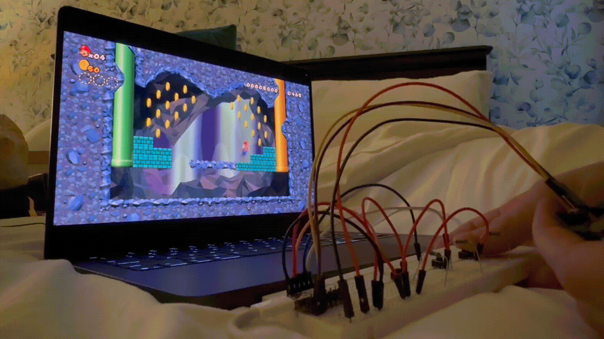
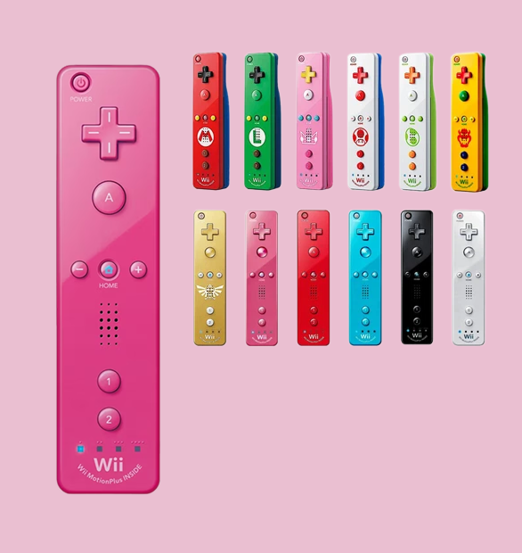
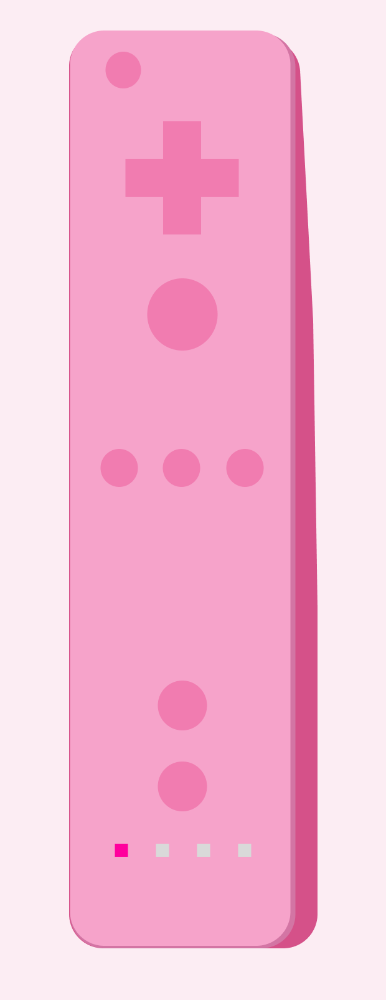

# Emoolii Remote

 

A custom game controller for playing Super Mario Bros on Dolphin Emulator.

For now, just a breaboard, joystick, some push buttons and ESP32-BLE-Gamepad

 
Runthrough with my prototype

Aiming for something like this:

<table align="center">
  <tr>
    <td align="center" valign="bottom">
      
       
      Wii remote inspo
    </td>
    <td>&emsp;&emsp;</td>
    <td align="center" valign="bottom">
      
       
      Custom design
    </td>
  </tr>
</table>
 